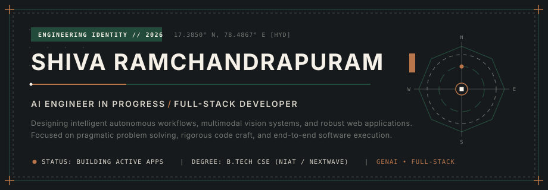
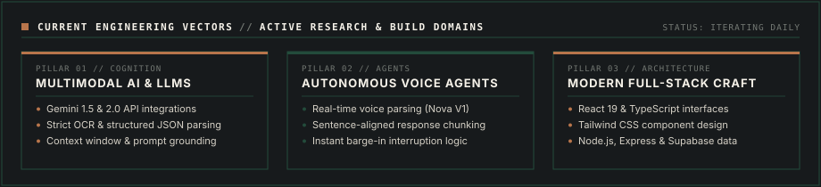
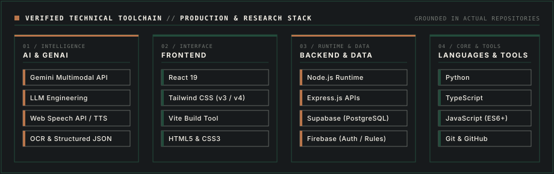
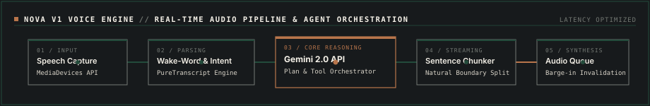
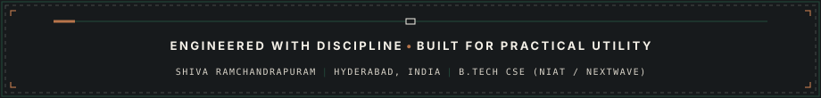

<!-- ================================================== -->
<!-- 01. HERO SECTION -->
<!-- ================================================== -->

 

<!-- ================================================== -->
<!-- 02. ABOUT ME -->
<!-- ================================================== -->

### `01 //` PROFILE & ARCHITECTURAL APPROACH

> *"Engineering intelligent systems by pairing foundational generative AI capabilities with responsive, dependable web architectures."*

I am an **Aspiring AI Engineer** and **Full-Stack Developer** currently pursuing my **B.Tech in Computer Science and Engineering** at **NIAT / NextWave Institute of Advanced Technologies** in Hyderabad, India.

My engineering methodology centers on **pragmatic problem solving**: translating cutting-edge model research into production-grade, intuitive software. Rather than treating AI as a black box or an isolated novelty, I build integrated systems where real-time speech processing, multimodal vision, and structured prompt pipelines interface directly with modern web clients and robust backends.

* **Primary Discipline:** Artificial Intelligence Engineering &amp; Autonomous Agent Systems
* **Academic Foundation:** B.Tech Computer Science &amp; Engineering (NIAT / NextWave)
* **Core Working Philosophy:** Learn by building, ground every solution in solid software fundamentals, and iterate with discipline.

 

  

<!-- ================================================== -->
<!-- 03. CURRENT FOCUS -->
<!-- ================================================== -->

### `02 //` CURRENT RESEARCH &amp; BUILD DOMAINS

  

 

* **Multimodal AI &amp; LLM Engineering:** Implementing production pipelines using the **Gemini API** (`@google/genai`). Designing structured prompt schemas, deterministic JSON outputs, strict OCR verification guards, and multimodal context ingestion.
* **Autonomous Agent Loops &amp; Voice Systems:** Developing voice-first intelligent agents with low-latency speech recognition, sentence-aligned audio chunking, intent routing, and real-time barge-in interruption handling (as featured in Nova V1).
* **Modern Full-Stack Web Craft:** Architecting scalable frontend applications with **React 19**, **TypeScript**, and **Tailwind CSS**, coupled with lightweight REST services in **Node.js** and persistent state in **Supabase** and **Firebase**.

 

  

<!-- ================================================== -->
<!-- 04. TECHNOLOGY STACK -->
<!-- ================================================== -->

### `03 //` VERIFIED TECHNICAL TOOLCHAIN

  

 

| Vector | Supported Technologies | Applied Implementation Scope |
| :--- | :--- | :--- |
| **AI &amp; GenAI** | `Gemini Multimodal API` `LLM Engineering` `Web Speech API` | Context grounding, prompt schemas, strict OCR guards, and conversational audio synthesis. |
| **Frontend Interfaces** | `React 19` `TypeScript` `Tailwind CSS` `HTML5` `CSS3` | Modern component systems, typed state architectures, and responsive editorial styling. |
| **Backend &amp; Data** | `Node.js` `Express.js` `Supabase (PostgreSQL)` `Firebase` | REST API endpoints, user authentication, security rules, and relational data vaults. |
| **Languages &amp; Tools** | `Python` `JavaScript (ES6+)` `Git` `GitHub` `Vite` `Vercel` | Core scripting, speech automation, version control discipline, and edge continuous deployment. |

 

  

<!-- ================================================== -->
<!-- 05. FEATURED PROJECTS -->
<!-- ================================================== -->

### `04 //` FEATURED ENGINEERING PROJECTS

<!-- 01. FLAGSHIP PROJECT: V1 AI VOICE ASSISTANT -->
<table>
  <tr>
    <td width="100%" valign="top">
      <h4>★ FLAGSHIP PROJECT &nbsp;|&nbsp; 01. V1 – AI Voice Assistant (Nova)</h4>
      
<b>Domain:</b> Voice-First Conversational AI &amp; Real-Time Agent Intelligence

      
Nova is an intelligent, voice-first desktop artificial intelligence assistant engineered for low-latency conversational speech and autonomous task orchestration. The system integrates continuous speech recognition, deterministic wake-phrase detection, and generative language modeling with the <b>Gemini API</b> to parse user intents, execute multi-step workflows, and stream synthesized audio with real-time barge-in interruption handling.

      
      

         
        
         
      

      
<b>Verified Tech Stack:</b> <code>Gemini API (@google/genai)</code> <code>Node.js</code> <code>Express</code> <code>React 19</code> <code>TypeScript</code> <code>Tailwind CSS</code> <code>Firebase</code> <code>Web Speech API</code>

      
<b>Key Architecture:</b> MediaDevices Speech Ingestion &bull; PureTranscript Wake-Word Filter &bull; AgentOrchestrator Intent Routing &bull; Sentence-Aligned Response Chunker &bull; Dynamic TTS Provider Factory &bull; Instant Barge-In Interruption Invalidation

      

        <a href="https://github.com/Ramchandrapuramshiva/V1"><b>View GitHub Repository &rarr;</b></a>
      

    </td>
  </tr>
</table>

<!-- 02 & 03: APPLIED APPLICATIONS -->
<table>
  <tr>
    <td width="50%" valign="top">
      <h4>02. MediLens AI</h4>
      
<b>Domain:</b> AI-Powered Healthcare Assistance &amp; Vision Intelligence

      
An assistive medical document intelligence prototype built to analyze prescription images, medicine packaging, and clinical lab reports. Employs multimodal computer vision via the <b>Gemini Vision API</b> alongside a strict OCR guard to transcribe, validate, and structure medical text into clear summaries without hallucinating ambiguous medical data.

      
<b>Verified Tech Stack:</b> <code>Gemini Vision API</code> <code>React 19</code> <code>Tailwind CSS</code> <code>Supabase</code> <code>Vite</code> <code>Framer Motion</code>

      

        <a href="https://github.com/Ramchandrapuramshiva/medilens-ai"><b>View GitHub Repository &rarr;</b></a>
      

    </td>
    <td width="50%" valign="top">
      <h4>03. CineStream</h4>
      
<b>Domain:</b> Media Discovery Application &amp; Content Navigation

      
A Netflix-inspired media discovery platform engineered for fast catalog exploration and trailer playback. Features an editorial dark-mode interface, responsive categorized movie exploration, dynamic search filtering, and seamless external media catalog integrations.

      
<b>Verified Tech Stack:</b> <code>React 19</code> <code>TypeScript</code> <code>Tailwind CSS</code> <code>Vite</code> <code>Supabase</code> <code>TMDB API</code>

      

        <a href="https://github.com/Ramchandrapuramshiva/cinestream"><b>View GitHub Repository &rarr;</b></a>
      

    </td>
  </tr>
</table>

 

  

<!-- ================================================== -->
<!-- 06. GITHUB ACTIVITY & METRICS -->
<!-- ================================================== -->

### `05 //` REPOSITORY METRICS &amp; ACTIVITY

  

    

  

 

  

<!-- ================================================== -->
<!-- 07. CONNECT WITH ME -->
<!-- ================================================== -->

### `06 //` NETWORK &amp; COLLABORATION

I am always keen to collaborate on generative AI experiments, autonomous agent architectures, and full-stack software products. Feel free to connect across my verified channels:

   

  
  &nbsp;&nbsp;
  
  &nbsp;&nbsp;
  

    
  <i>Inquiries and project collaboration proposals are monitored regularly via GitHub and direct email.</i>

 

<!-- ================================================== -->
<!-- 08. FOOTER -->
<!-- ================================================== -->

  

