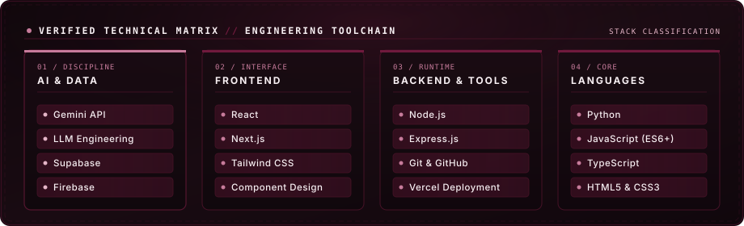

<div align="center">

<!-- ================================================== -->
<!-- 01. ANIMATED HERO -->
<!-- ================================================== -->



<br />

[](https://github.com/Ramchandrapuramshiva)
[](https://github.com/Ramchandrapuramshiva)
[](https://github.com/Ramchandrapuramshiva)
[](https://github.com/Ramchandrapuramshiva)


</div>

<!-- ================================================== -->
<!-- 02. INTRODUCTION -->
<!-- ================================================== -->

### `01 //` PROFILE & ARCHITECTURE

> *"Engineering intelligent systems by pairing generative AI capabilities with responsive, production-ready web interfaces."*

I am an **Aspiring AI Engineer** and **Full-Stack Developer** currently pursuing my **B.Tech in Computer Science and Engineering** at **NIAT / NextWave Institute of Advanced Technologies**. 

My core methodology is rooted in **pragmatic engineering**: learning by building, testing real-world edge cases, and transforming emerging AI models into intuitive, dependable software applications. Rather than relying on purely theoretical exercises, I focus on integrating LLMs, multimodal vision, speech pipelines, and full-stack web architectures into practical solutions.

- **Current Discipline:** AI Engineering & Autonomous Agent Workflows
- **Undergraduate Studies:** B.Tech Computer Science & Engineering (NIAT / NextWave)
- **Base of Operations:** Hyderabad, India
- **Core Ethos:** Build rigorously, iterate continuously, and ground every experiment in solid fundamentals.

<br />

<div align="center">
  
</div>

<!-- ================================================== -->
<!-- 03. CURRENT FOCUS -->
<!-- ================================================== -->

### `02 //` CURRENT ENGINEERING FOCUS

```
┌─────────────────────────────────────────────────────────────────────────────┐
│ ACTIVE EXPLORATION & APPLIED RESEARCH VECTORS                               │
└─────────────────────────────────────────────────────────────────────────────┘
```

* **Generative AI & LLM Engineering**  
  Developing applications powered by the **Gemini API** and contemporary large language models. Investigating structured prompt engineering, system framing, context window optimization, and multimodal reasoning (text, audio, vision).

* **Intelligent AI Agents & Autonomous Workflows**  
  Designing conversational agent architectures and task orchestration loops. Exploring function calling, memory persistence, tool execution, and voice-enabled interactions (e.g., Nova Voice Assistant).

* **Modern Full-Stack Web Development**  
  Architecting high-performance client experiences with **React**, **Next.js**, and **Tailwind CSS**, coupled with clean, scalable backend endpoints in **Node.js**, **Express**, and **Python**.

* **Practical Software Engineering Fundamentals**  
  Writing clean, modular code, enforcing version control discipline with **Git & GitHub**, managing state with **Supabase** and **Firebase**, and deploying continuous delivery builds on **Vercel**.

<br />

<div align="center">
  
</div>

<!-- ================================================== -->
<!-- 04. TECH STACK -->
<!-- ================================================== -->

### `03 //` TECHNICAL MATRIX

<div align="center">
  
</div>

<br />

| Vector | Core Technologies | Focus & Application |
| :--- | :--- | :--- |
| **AI & Intelligent Data** | `Gemini API` `LLM Engineering` `Supabase` `Firebase` | Context injection, multimodal prompting, agent logic, and persistent vector/relational data. |
| **Frontend Engineering** | `React` `Next.js` `Tailwind CSS` `HTML5` `CSS3` | Modern component architectures, responsive user interfaces, and fast edge-rendered web applications. |
| **Backend & Environments**| `Node.js` `Express.js` `Git` `GitHub` `Vercel` | RESTful API services, version control lifecycle, continuous deployment, and runtime hosting. |
| **Core Languages** | `Python` `JavaScript (ES6+)` `TypeScript` | Scripting, AI/ML glue code, speech synthesis automation, and type-safe web development. |

<br />

<div align="center">
  
</div>

<!-- ================================================== -->
<!-- 05. FEATURED PROJECTS -->
<!-- ================================================== -->

### `04 //` FEATURED ENGINEERING PROJECTS

<!-- 01. FLAGSHIP PROJECT: V1 AI VOICE ASSISTANT -->
<table>
  <tr>
    <td width="100%" valign="top">
      <h4>★ FLAGSHIP PROJECT &nbsp;|&nbsp; 01. V1 – AI Voice Assistant (Nova)</h4>
      <p><b>Domain:</b> Voice-First Conversational AI &amp; Real-Time Agent Intelligence</p>
      <p>An intelligent, voice-first artificial intelligence assistant engineered for low-latency natural conversation and desktop task execution. Nova integrates real-time speech recognition, deterministic wake-phrase detection, and generative language modeling with the <b>Gemini API</b> to classify user intent, plan multi-step actions, and stream spoken responses with instant barge-in interruption handling.</p>
      <p><b>Verified Tech Stack:</b> <code>Gemini API (@google/genai)</code> <code>Node.js</code> <code>Express</code> <code>React 19</code> <code>TypeScript</code> <code>Tailwind CSS</code> <code>Firebase</code> <code>Web Speech API</code></p>
      <p><b>Key Architecture:</b> Continuous Speech Recognition Engine &bull; Task &amp; Intent Agent Orchestrator &bull; Sentence-Aligned Response Chunker &bull; Modular TTS Provider Factory &bull; Real-Time Barge-In Invalidation</p>
      <p>
        <a href="https://github.com/Ramchandrapuramshiva/V1"><b>View GitHub Repository &rarr;</b></a>
      </p>
    </td>
  </tr>
</table>

<!-- 02 & 03: APPLIED APPLICATIONS -->
<table>
  <tr>
    <td width="50%" valign="top">
      <h4>02. MediLens AI</h4>
      <p><b>Domain:</b> AI-Powered Healthcare Assistance &amp; Vision Intelligence</p>
      <p>An assistive healthcare intelligence prototype built to analyze medical prescriptions, lab reports, and medicine packaging. Employs multimodal vision via the <b>Gemini Vision API</b> alongside a strict OCR-guard pipeline to transcribe and structure clinical documents into clear summaries without hallucinating ambiguous medical data.</p>
      <p><b>Verified Tech Stack:</b> <code>Gemini Vision API</code> <code>React 19</code> <code>Tailwind CSS</code> <code>Supabase</code> <code>Vite</code> <code>Framer Motion</code></p>
      <p>
        <a href="https://github.com/Ramchandrapuramshiva/medilens-ai"><b>View GitHub Repository &rarr;</b></a>
      </p>
    </td>
    <td width="50%" valign="top">
      <h4>03. CineStream</h4>
      <p><b>Domain:</b> Media Discovery Application &amp; Content Navigation</p>
      <p>A Netflix-inspired media discovery application designed for rapid content browsing and video previews. Features an editorial dark-mode interface, responsive categorized movie exploration, dynamic search filtering, and seamless media catalog integrations.</p>
      <p><b>Verified Tech Stack:</b> <code>React 19</code> <code>TypeScript</code> <code>Tailwind CSS</code> <code>Vite</code> <code>Supabase</code> <code>TMDB API</code></p>
      <p>
        <a href="https://github.com/Ramchandrapuramshiva/cinestream"><b>View GitHub Repository &rarr;</b></a>
      </p>
    </td>
  </tr>
</table>

<br />

<div align="center">
  
</div>

<!-- ================================================== -->
<!-- 06. GITHUB CONTRIBUTION HEATMAP -->
<!-- ================================================== -->

### `05 //` DEVELOPMENT CADENCE & ACTIVITY

<div align="center">
  
  
  <br /><br />

  
</div>

<br />

<div align="center">
  
</div>

<!-- ================================================== -->
<!-- 07. GITHUB STATISTICS -->
<!-- ================================================== -->

### `06 //` METRICS & REPOSITORY TELEMETRY

<div align="center">
  <table border="0">
    <tr>
      <td align="center" valign="middle">
        
      </td>
      <td align="center" valign="middle">
        
      </td>
    </tr>
  </table>
</div>

<br />

<div align="center">
  
</div>

<!-- ================================================== -->
<!-- 08. CONNECT WITH ME -->
<!-- ================================================== -->

### `07 //` NETWORK & COLLABORATION

I am always keen to collaborate on generative AI experiments, open-source projects, and full-stack web applications. Feel free to reach out or connect across my verified channels:

<div align="center">
  <br />

  <a href="https://github.com/Ramchandrapuramshiva">
    
  </a>
  &nbsp;&nbsp;
  <a href="https://linkedin.com/in/">
    
  </a>
  &nbsp;&nbsp;
  <a href="mailto:">
    
  </a>

  <br /><br />
  <sub><i>Note: Direct inquiries and project collaborations are monitored regularly via GitHub.</i></sub>
</div>

<br />

<!-- ================================================== -->
<!-- 09. ANIMATED FOOTER -->
<!-- ================================================== -->

<div align="center">
  
</div>
