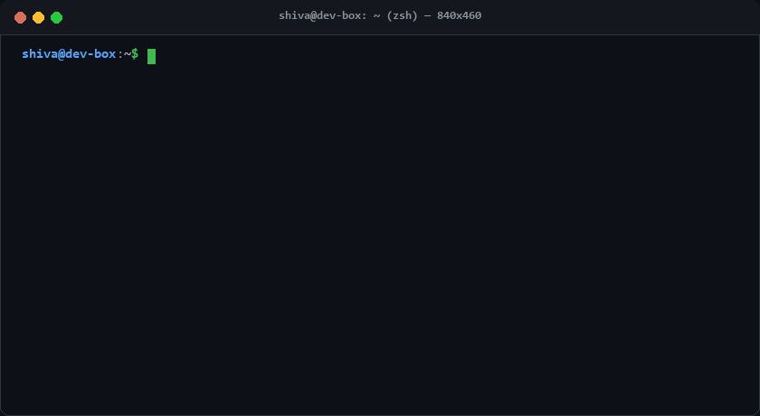
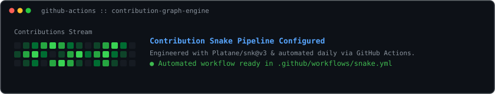

<!--
====================================================================
SHIVA RAMCHANDRAPURAM - PREMIUM GITHUB PROFILE COMMAND CENTER
====================================================================
-->

<div align="center">

  <!-- Dynamic Typing Header Banner -->
  <a href="https://github.com/Ramchandrapuramshiva">
    
  </a>

  <br />

  <!-- Animated Developer Terminal GIF -->
  

</div>

<br />

### `// 01. EXECUTIVE OVERVIEW`

```yaml
identity:
  name: "Shiva Ramchandrapuram"
  designation: "AI Engineer in Progress & Full-Stack Developer"
  core_mission: "Architecting generative AI applications, intelligent agents, and scalable web ecosystems"
  learning_focus: "LLM Orchestration, Autonomous Agent Workflows, Prompt Engineering, Systems Architecture"
  working_style: "Pragmatic, test-driven, user-centric, and learning-by-building"
```

---

### `// 02. VERIFIED TECHNICAL STACK`

#### **Currently Building With**


#### **AI Engineering & Emerging Focus**


---

### `// 03. FEATURED PROJECTS SHOWCASE`

<table>
  <thead>
    <tr>
      <th width="65%">Project, Stack & Highlights</th>
      <th width="35%">Repository & Status</th>
    </tr>
  </thead>
  <tbody>
    <tr>
      <td>
        <b>🎬 CineStream</b><br />
        <sub><code>React</code> • <code>TypeScript</code> • <code>Vite</code> • <code>Tailwind CSS</code> • <code>TMDB API</code></sub><br /><br />
        Modern entertainment & movie discovery platform inspired by streaming interfaces. Features dynamic catalog exploration, responsive media grids, smooth UI transitions, and modular component architecture.
      </td>
      <td valign="top">
        <a href="https://github.com/Ramchandrapuramshiva/cinestream"><b>Code Repository ➜</b></a><br /><br />
        <br />
        <sub><i>Live deployment undergoing update</i></sub>
      </td>
    </tr>
    <tr>
      <td>
        <b>🩺 MediLens AI (MediTrack AI)</b><br />
        <sub><code>JavaScript</code> • <code>AI Assistant</code> • <code>Health Informatics</code></sub><br /><br />
        AI healthcare diagnostic assistant designed to analyze handwritten prescriptions, extract clinical insights from medical reports, and clarify medication guidance with conversational AI safety guardrails.
      </td>
      <td valign="top">
        <a href="https://github.com/Ramchandrapuramshiva/medilens-ai"><b>Code Repository ➜</b></a><br /><br />
        <br />
        <sub><i>Live deployment undergoing update</i></sub>
      </td>
    </tr>
    <tr>
      <td>
        <b>🎙️ V1 AI Voice Assistant</b><br />
        <sub><code>Python</code> • <code>Speech-to-Text</code> • <code>LLM Reasoning</code> • <code>Voice Synthesis</code></sub><br /><br />
        Conversational intelligent voice agent engineered for real-time natural speech processing and multi-turn dialogue comprehension.
        <br />
        <sub>• <b>Architecture & Audio Pipeline:</b> Designed & Tested</sub><br />
        <sub>• <b>Desktop Automation & Streaming:</b> In Active Development</sub>
      </td>
      <td valign="top">
        <b>[Private Pipeline]</b><br /><br />
        <br />
        <sub><i>Active R&D Phase</i></sub>
      </td>
    </tr>
    <tr>
      <td>
        <b>💎 Modern Web Portfolio Ecosystem</b><br />
        <sub><code>React</code> • <code>Vite</code> • <code>TypeScript</code> • <code>Tailwind CSS</code> • <code>UX Design</code></sub><br /><br />
        High-performance responsive web experience featuring bespoke editorial styling, fluid scrolling animations, modern typography, and optimized asset delivery.
      </td>
      <td valign="top">
        <a href="https://github.com/Ramchandrapuramshiva/pariha-pedda-portfolio"><b>Code Repository ➜</b></a><br /><br />
        <a href="https://pariha-pedda-portfolio.vercel.app"><b>Live Application ➜</b></a><br /><br />
        
      </td>
    </tr>
  </tbody>
</table>

---

### `// 04. CONTRIBUTION PIPELINE & CODE ACTIVITY`

<!-- Dynamic Contribution Snake Animation Generated via Platane/snk -->
<div align="center">
  <picture>
    <source media="(prefers-color-scheme: dark)" srcset="https://raw.githubusercontent.com/Ramchandrapuramshiva/Ramchandrapuramshiva/output/github-contribution-grid-snake-dark.svg">
    <source media="(prefers-color-scheme: light)" srcset="https://raw.githubusercontent.com/Ramchandrapuramshiva/Ramchandrapuramshiva/output/github-contribution-grid-snake.svg">
    
  </picture>
</div>

<br />

---

### `// 05. GITHUB TELEMETRY & ACTIVITY METRICS`

<div align="center">
  <a href="https://github.com/Ramchandrapuramshiva">
    
  </a>
  &nbsp;&nbsp;
  <a href="https://github.com/Ramchandrapuramshiva">
    
  </a>
</div>

<br />

---

### `// 06. CONNECT & COLLABORATE`

```bash
$ ping -c 1 shiva.dev
64 bytes from Ramchandrapuramshiva: icmp_seq=1 ttl=64 time=0.042 ms
--- status: open for collaborations on AI engineering, LLM products, and full-stack software.
```

<div align="center">
  <a href="https://github.com/Ramchandrapuramshiva">
    
  </a>
  &nbsp;
  <a href="mailto:shiva61514@gmail.com">
    
  </a>
</div>

<br />

<div align="center">
  <sub><code>shiva@profile:~$ exit 0 // Built with passion, code, and intelligence.</code></sub>
</div>
